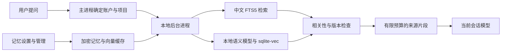

# 本地记忆替代方案与实测结论

日期：2026-11-07。结论：**采用 SQLite + sqlite-vec + 本地语义检索作为下一阶段技术路线；隔离样机的召回、延迟和数据隔离可行性通过，尚未接入正式产品。** Hindsight 统一后端路线已按用户最新要求停止，不再等待服务器。

## 为什么选这条路线

EWork 已经有 SQLite 存储和自己的记忆管理服务。问题集中在关键词召回、固定分类加分，以及无关背景可能进入提示词；更换一个数据库名字不能改善这些问题。

建议保留现有来源、版本、候选、人工锁定、删除抑制、账户和项目规则，增加本地语义检索与使用前的相关性判断。sqlite-vec 是可由 Node 直接加载的 SQLite 扩展，无需再部署数据库服务器；这次已经在 Node/macOS arm64 实跑。[sqlite-vec 官方 Node 文档](https://alexgarcia.xyz/sqlite-vec/js.html)

Mem0 可以作为应用内库，不能笼统称它必须部署服务。但其默认 OSS 组合还涉及 LLM、embedding、向量存储和历史存储；对已有 EWork 治理层，本轮选用嵌入式基础库更直接。[Mem0 OSS 组件说明](https://docs.mem0.ai/open-source/overview)

图中“相关性与版本检查”是产品设计，样机已实现状态/过期过滤，但尚未实现可靠的无答案拒用策略。当前会话模型可以是用户现有的云端模型；本地存储和本地检索不等于所有 AI 处理都离线。

## 实测方法

- 运行环境：Apple M2 Max、12 核；Node 22.23.2 / macOS arm64。代码在独立 feature worktree，未构建或替换共享客户端。
- 组件：sqlite-vec 0.1.9、ONNX Runtime Node 1.31.1、Hugging Face tokenizers 0.2.0；multilingual-e5-small 官方固定快照 INT8，384 维。遵循模型要求的 query/passage 前缀和平均池化、归一化。[模型卡](https://huggingface.co/intfloat/multilingual-e5-small)
- 46 条原始合成记忆与 46 题，其中 40 正例、6 无答案；附加 20 条此前未测的合成记忆与 24 题，其中 20 正例、4 无答案。随后加入 1,000 条按冻结规则生成的办公干扰记忆，共 1,066 条。
- 原始正例中有 14 道语义改写题。保留集已在前阶段生成并冻结；不根据本次结果修改内容。部分问题需要同时找到两个来源。
- 并发测试为完整父进程→后台进程→查询向量→SQLite→证据打包→返回链路。每档 210 次，5 秒超时计入失败和延迟；没有查询向量缓存。聊天模型生成、前端渲染不在此延迟内。
- 纯语义、纯词法、固定融合在运行前同时确定。融合参数 RRF k=60、语义 0.75 / 词法 0.25，没有按结果继续调参。
- 测试 key 仅保护合成实验数据；生产应沿用系统安全存储。测试 worker 的 owner 来自受信任的测试程序，不是已完成真实 Electron IPC 鉴权验收。

## 召回结果

下表为扩容到 **1,066 条**之后的完整来源 top-5 命中，分母只含有答案的题目：

| 策略 | 原 40 题 | 原改写 14 题 | 新保留集 20 题 | 原题完整 1,200 字节证据包 | 新题完整证据包 |
| --- | --- | --- | --- | --- | --- |
| 纯语义 | 39/40，97.5% | 13/14，92.9% | 20/20，100% | 39/40，97.5% | 20/20，100% |
| 中文词法 | 37/40，92.5% | 12/14，85.7% | 19/20，95% | 37/40，92.5% | 20/20，100% |
| 固定融合 | 38/40，95% | 12/14，85.7% | 20/20，100% | 39/40，97.5% | 20/20，100% |

扩容前 66 条数据中，纯语义为原题 40/40、新题 20/20；固定融合为原题 39/40、新题 20/20。数字是人工合成集的来源召回，不能外推为所有中文对话的准确率。

结果支持把语义检索放在主要位置，并保留关键词对编号、术语的补充能力；**不支持直接把固定融合当成最终最佳排序**。纯语义在“消息面板排版、鼠标移走时注意什么”的改写题被大量相似干扰记录挤出前五；融合还漏了离线读写与暂缓支付模块的两题。最终排序需要另加独立评估集验证。

无答案题单独统计：纯语义和固定融合均为 **10/10 仍返回相似候选**，词法为 9/10。这不代表模型已经产生 10 次幻觉，但说明样机不能直接把最近邻候选视作可用事实。未知题的最高相似度仍可能超过 0.90；不能简单以“相似度高”作为可靠答案依据。本轮没有测最终答案生成。

## 延迟、并发和资源

以下压测使用固定融合，共 630 次，失败 0、超时 0；所有响应的候选都核对了账户、项目和状态：

| 同时请求数 | p50 | p95 | p99 | 吞吐 |
| --- | --- | --- | --- | --- |
| 1 | 5.61 ms | 7.19 ms | 7.49 ms | 178.9 次/秒 |
| 3 | 16.85 ms | 19.96 ms | 20.46 ms | 179.9 次/秒 |
| 10 | 56.06 ms | 62.07 ms | 63.04 ms | 179.3 次/秒 |

这是单个后台进程串行执行的队列结果，不是 10 个独立模型并行，也不是服务端多用户容量证明。

- 有本地模型缓存时，工作进程初始化完整往返约 715 ms；带持久数据重启约 869 ms。此前独立冒烟的首次模型加载为 1.74 秒，不能把热态 7 ms 当作首次启用成本。
- 1,000 条新增干扰记忆向量化并保存约 7.49 秒，属于后台建索引成本。
- worker 测得 RSS 检查点约 431–655 MiB；第一进程压测峰值约 655 MiB。它不是完整 Electron 应用占用，采样也可能漏掉瞬时峰值。不沿用之前的桌面硬性内存门槛。
- 所以建议按需加载语义 worker、空闲释放，并保留无模型的词法能力；这部分生命周期尚需产品实现。不是承诺本地语义功能“零内存”。
- 合成加密数据库约 2.28 MiB（重启探针后 1,068 条）。NPM 运行依赖约 304 MiB，包含多平台二进制；当前 macOS arm64 的 ONNX 二进制目录约 88.6 MiB。模型权重 118,346,824 字节，另有 tokenizer 文件。不能把开发依赖目录大小直接当成最终安装包增量。

## 隔离、持久化和删除

- 4 项聚焦测试通过：跨账户/项目同名 ID 更新删除隔离；生效/已替代/候选/停用/过期筛选；编辑删除后词法索引清理；加密正文和向量重开、错误密钥拒绝读取。
- 合成攻击边界：未授权项目被拒绝；两账户和同一账户两个项目使用同名 canary，删除 A/alpha 后重启真实 worker，A/alpha 不再返回，B/alpha 和 A/beta 保留正确内容。
- 630 次负载请求及三种策略的扩容质量测量，发现越界候选为 0。
- 只证明样机上下文和 SQL 筛选正确；真实应用账户切换、旧请求取消、来源授权、迁移恢复仍须接入阶段验收。
- 所有本次 worker 已退出；未启动 Hindsight/PostgreSQL，未导入真实用户记忆。

## 接入后应具备的产品能力

1. 跨会话找回中文偏好、背景和决策，支持换一种说法提问；精确编号和中英混合术语仍可由关键词检索补充。
2. 按账户与项目使用记忆，当前事实和历史版本分开，过期进展不自动当作现状。
3. 回答可追溯到来源与修订；用户能改正、停用、删除，旧后台结果不能把已删除记忆重新写回。
4. 查看与检索可在本地完成，无需维护独立服务器；自动提炼继续使用已配置的会话模型，是否联网取决于该模型。
5. 首版不含多设备自动同步，也不因采用向量库自动获得长期规划、推理或可靠事实判断。

## 前端设置改造范围（设计，尚未实现）

| 分区 | 用户可用功能 |
| --- | --- |
| 使用方式 | 分开控制“使用已有记忆”和“自动保存新记忆”；当前对话临时关闭；明确自动整理会调用哪个会话模型 |
| 我的记忆 | 搜索、按个人/项目和分类筛选；新增、编辑、停用、删除；来源、确认时间、最近使用记录 |
| 待确认 | 查看待确认与冲突条目，采用或忽略；旧版本与当前生效内容分开 |
| 本地检索 | 语义检索开关；模型准备/索引状态；重建索引、存储占用；普通界面不显示向量维度等开发参数 |
| 数据管理 | 导入/导出；Markdown 明文镜像的明确说明与选择；清除记忆及其派生索引，说明原聊天记录仍保留 |

当前产品 `use/auto` 被强制联动，不能只改前端两个开关就宣称支持独立控制；服务与 runtime 契约也要一起改。现有 `记忆.md` 是明文文件，数据库加密不能代表它也已加密。

## 后续实施顺序

1. 先补可用证据判断和独立无答案集：保留当前请求优先级，拒绝把无依据候选写成结论；不要按这 10 个负例硬编码规则。
2. 接入可取消的本地 worker，账户 epoch 与索引修订校验；关闭或切换账户立即失效。索引失败时保留可解释的词法降级。
3. 最初复用现有加密存储接口，增加向量缓存；再按需要迁移到逐条加密持久化，验证备份、失败恢复、删除和重建。
4. 改造独立开关、记忆管理与状态界面；按多 session 集成规则进入 main，再验证真实客户端保存→召回→修改→删除→重启。此 worktree 不构建共享客户端。

**判定：技术路线可继续采用；产品交付仍待以上步骤，不能根据本报告宣称记忆架构和设置界面已替换。**

## 复现与证据

- 设计与冻结门槛：`docs/superpowers/plans/2026-11-07-local-memory-alternative.md`。
- 可运行代码与依赖锁：`experiments/local-memory-spike/`，执行方式见其 README。
- 原始证据目录：`/Users/heyafeng/.codex/visualizations/2026/11/06/01a1b345-224e-7591-a9d9-34bf882b4aa6/local-memory-spike/evidence/`。
- 主要文件：`results.json`（逐题候选、完整打包、失败、队列/embedding/SQLite 时长、负载和重启结果）、`frozen-input.json`、`input-manifest.json`。合成测试 key 不应提交或共享。
- 只运行上述记忆样机的聚焦测试及实验，没有执行全功能测试、推送或发布。
