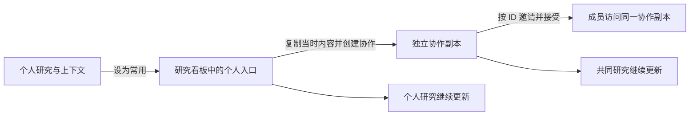
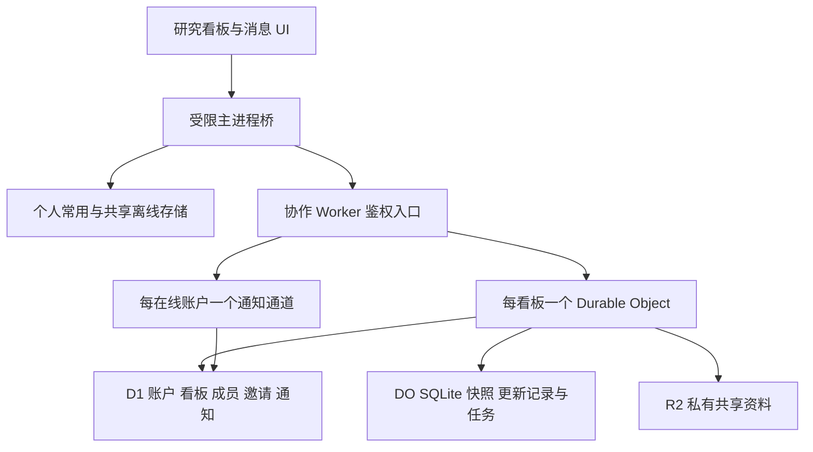

# EWork Odyssey 研究看板与实时协作设计

日期：2026-09-09。文档性质：产品与架构设计，供评审和后续实现使用；本文不表示功能已经实现或上线。

核验基线：私有仓库 `sherlock-desktop` 本地 main `335fae8a555a65ea48fcc42c79f03940cb263898`，package.json 为 0.9.4。当前任务最初所在的旧 `dsh` 目录为 0.8.1，本功能以后续核验过的私有仓库为准。

## 1. 已确认需求与建议默认值

用户已确认：

- 在研究模式把当前画布及其研究上下文设为常用。
- 左侧「新对话 / 新研究」下方、「工作区」上方增加「研究看板」。
- 常用研究才可以创建共享协作看板。
- 每个账户有固定的专有 ID，通过填写 ID 邀请其他用户。
- 左下角原上拉箭头的位置改为通知铃铛；有消息时出现红点。
- 新邀请到达时，在铃铛上方展示气泡，提供接受、拒绝。
- 共享时创建独立副本；共享副本的编辑不改变原研究。
- 协作看板顶部右侧展示当前在该看板中的用户头像，悬停显示用户名；位置与形态以用户提供的标题栏绿框和圆形头像参考为准。

本方案建议的默认值：10 位数字用户 ID、邀请 7 天有效、第一版每板最多 10 名成员、默认邀请权限为可编辑、邀请气泡展示 10 秒。它们属于可评审的产品选择，不是平台能力上限或用户已经逐项确认的要求。

2026-09-09 补充设计建议：将「取消共享」定义为结束其他成员访问，将「归档协作」保留为全员只读；两者的区别、在场头像和取消共享后的客户端状态见第 3.1、8.1、8.2 节。用户本轮提出了取消共享后行为的问题，本文提供建议语义，不将其记为已逐项确认的需求。

## 2. 核心对象与生命周期



### 2.1 个人常用研究

- 设为常用创建持久化看板记录和侧栏入口，指向原个人研究；重复点击不会重复创建。
- 默认名称沿用研究名称；支持重命名和拖动排序。个人看板名称可随关联研究一起更新。
- 从原工作区或常用入口进入，都是同一份个人研究。重新进入直接打开研究模式。
- 取消常用只移除常用入口。原研究仍在原位置，已有协作副本继续存在。
- 删除原研究时同步处理它的个人常用入口；独立协作副本及已复制附件不受影响。
- 个人常用记录保存在本机，未登录也可使用；第一版不提供个人研究跨设备云同步。

### 2.2 协作副本

- 第一次在个人常用研究中点击「共享协作」，创建新的 sharedBoardId。
- 默认名称为「原研究名 · 协作」，创建者和受邀者看到同一名称；只有所有者可改共享名称。
- 创建者侧栏同时保留个人研究与协作副本，后者使用成员图标，并在看板顶部明确标注「协作」。
- 协作副本包含复制时点的画布和研究上下文。此后双方独立演进，第一版不提供自动回写、自动再次导入原研究或双向合并。
- 创建者向同一团队追加邀请，操作现有副本的「管理协作」，所有成员进入同一个 sharedBoardId。每个邀请不创建新副本。
- 原研究再次点击共享时列出从它创建的现有副本，首选管理已有副本；「新建协作副本」作为显式独立操作，用于不同团队。
- 不显示 sourceSessionId、本地绝对路径等内部信息给受邀者；原研究关联仅供创建者定位来源。

### 2.3 收藏位置与访问权限

- 侧栏顺序、是否显示和折叠状态属于个人偏好；它们不决定云端成员资格。
- 协作副本创建成功后固定到所有者的研究看板；邀请接受后固定到受邀者的研究看板。
- 移除协作看板的侧栏入口不退出协作。研究看板菜单提供「管理看板」，可查看和重新固定仍有权限的协作看板。
- 「退出协作」「移除成员」「取消共享」「归档协作」是独立操作，不与取消常用混用。

## 3. 研究模式与侧栏交互

侧栏结构：

```text
[ 新对话 ] [ 新研究 ]

研究看板                      ⋯
  ☆ 黄金价格研究
  ♧ 黄金价格研究 · 协作
  ♧ 医药行业跟踪 · 协作

工作区                       原有工具
  测试集
  黄金价格研究
  …

[头像 用户名]          [铃铛·] [更新入口（有更新时）]
```

- 研究模式顶部提供星标，未常用时提示「设为常用」，已常用时提示「取消常用」。鼠标提示与键盘可访问名称一致。
- 普通未常用研究不显示共享协作入口；设为常用后显示「共享协作」。未登录点击时进入登录，成功后返回原共享流程。
- 私人常用研究保持本地保存；只有明确创建协作副本才上传内容。
- 研究看板为空时保留标题和一行引导：「在研究中设为常用，固定到这里」。支持折叠；过长列表在可用高度内滚动，仍能访问工作区。
- 看板行菜单按身份展示：个人入口为重命名、取消常用、共享协作；协作入口为打开、成员信息、移出侧栏，以及权限允许的管理或退出操作。
- 进入看板不额外挂载第二个输入框。继续复用现有研究对话、底部输入和组件选择能力。
- 点状网格、主题、组件操作、个人缩放与平移继续沿用当前视觉体系。

### 3.1 当前看板在场头像

- 位置：研究画板标题栏右端、右侧对话/文件面板分界线左侧，位于用户标注的绿框区域；不放入右侧对话面板，也不覆盖画布组件。
- 采用约 28 px 的圆形头像，间距约 6 px，保持与标题栏垂直居中。显示真实账户头像；没有图片时使用中文用户名首字或大写英文首字母，沿用账户头像规则。
- 只展示已获访问权限、正在当前看板研究视图中的用户，包括自己与仅查看成员。应用中在线但正在另一块看板的用户、离线成员、尚未接受邀请的人不在头像组出现。
- 同一账户多设备/多窗口进入同一看板仅显示一个头像；任一有效在场连接仍在时保留该用户。
- 默认显示最多 5 个头像，超出用「+N」收纳；更窄的可用标题栏可以提前收纳，避免挤压研究标题或右侧面板。数量是去重后当前在场人数，不是全部成员数。
- 自己优先、其他人按本次进入顺序稳定排列，输入或移动光标不触发头像重新排序。
- 头像右下角小圆点表示在场状态：在线采用统一状态色；短暂连接恢复期间改为灰色，并在提示中写明「重新连接中」。各用户的画布光标颜色稳定分配，与头像外圈标识对应，不用随机变色表达在线状态。
- 悬停或键盘聚焦时，在头像下方显示两行提示：第一行完整用户名，第二行「创建者 / 可编辑成员 / 仅查看成员」，本人附「你」。长名称可换行，不能只显示被截断的文本。
- 点击头像组或「+N」打开成员浮层，分开显示「当前在场」和「全部成员」。所有者从此进入邀请及成员管理，普通成员只查看成员信息。
- 用户切换到其他看板或离开研究视图时主动退出在场状态；异常断线按租约过期移除，目标在 30 秒内清除旧头像。重连先确认权限，再重新加入头像组。
- 当前研究不共享、共享已被取消，或当前用户已失去访问权时，不再展示协作头像组。归档且仍共享的看板可显示当前只读访问者。
- 头像名称和身份以服务端账户/成员数据为准，客户端提交的在线状态不能自行指定他人身份。切换看板或账户后清理旧状态，避免短暂显示上一块看板的成员。

## 4. 用户专有 ID

- 显示格式为 `ID 4827 1936 05`（仅为示例），底层保存 10 位随机数字字符串，允许前导零。
- 由服务端分配，数据库唯一约束并在碰撞时重试；不使用注册顺序号，不允许用户修改或重复领号。
- 新用户注册时分配；存量账户在迁移中补齐。内部 UUID 保持原有身份用途，不用公开 ID 替换已有数据库主键。
- 账户信息中展示 ID 和复制按钮；点击左下角头像或用户名仍打开账户菜单，菜单也提供「复制我的 ID」。
- 邀请输入接受带空格或不带空格的完整 ID，统一为字符串；支持粘贴整段显示格式。数字不足时在输入处提示，不发起查询。
- 精确匹配后显示头像、用户名和完整 ID，再由用户点击「发送邀请」。不提供用户名模糊检索、用户目录或输入过程中逐位搜索。
- ID 是邀请定位信息，不是登录凭证。展示 ID 不赋予任何看板访问权。

## 5. 创建协作副本与发送邀请

### 5.1 用户流程

1. 从个人常用研究进入「共享协作」。
2. 显示协作名称、复制范围、组件/文件数量及总大小。范围包含画布、本次研究已保存的对话与引用资料。
3. 用户填写对方 ID，核对姓名/头像，选择「可编辑」或「仅查看」。
4. 点击「创建副本并邀请」；按钮文字已经说明会复制并共享上述内容，不再叠加通用确认弹窗。
5. 界面按实际阶段显示：准备研究内容、上传资料、创建协作副本、发送邀请。
6. 成功后在侧栏加入副本，显示「邀请已发送」和「打开协作看板」。不因后台上传完成而突然离开用户当前页面。

如果看板已经存在，使用「管理协作」邀请，跳过复制和上传原研究。

### 5.2 副本内容一致性

- 按明确的 sourceRevision 和 capturedAt 捕获一个一致时点，先冻结用于复制的内容，再开始异步上传；原研究可以继续编辑。
- 复制文件和素材的实际内容与版本，替换为协作范围内的 assetId。改变或删除原本机文件不影响副本已复制的内容。
- 组件、引用、连线和来源关系中的 ID 要统一重映射；复制历史消息也有新的记录 ID，保留作者与来源时间标记。
- 复制当时仍在运行的任务不迁移执行进程、重试队列或工具授权。保留当时可用的已保存结果，并标注「复制时未完成」；后续由成员在副本中重新发起。
- 文件不可读、文件版本在复制中变化、上传失败或超限时，显示具体失败项和重试入口；不会默默把缺失文件标成已共享。
- 全部必要资源持久化并校验可读取后，副本才能进入 active 状态并产生邀请。若用户决定不包含失败资料，先更新复制范围，再重试完成创建。
- 创建操作使用持久化幂等键和捕获版本；断网或超时后恢复同一操作，查询结果后继续，避免多出看板和重复邀请。
- 副本创建成功但邀请发送失败时保留副本，显示「副本已创建，邀请待重试」；重试只发送邀请。
- 未完成上传记录保留 24 小时以便重试，之后只回收该操作未被任何有效看板引用的对象。

### 5.3 邀请状态

```text
pending → accepted / declined / cancelled / expired
```

- 默认 7 天过期，由服务端时间决定。
- pending 邀请再次发送返回原邀请；禁止邀请自己、已加入成员或无效账户。
- 邀请的 boardId、接收人和权限版本由服务端绑定。被邀请者只能处理发给自己的邀请。
- 所有者可以撤销 pending 邀请。修改邀请权限会使旧邀请版本失效，生成新版本通知；受邀者按当前展示的权限决定。
- 接受、拒绝、撤销、过期的竞争由看板服务协调，以一次成功的状态转换为准。多设备重复接受返回既有结果，不重复创建成员。
- 接受操作完成成员写入、邀请状态更新与待发送通知事件的持久化后才返回成功；实时广播失败不能撤销已经生效的成员资格。
- 邀请已经过期、撤销或看板已归档/取消共享时，旧气泡的操作返回当前状态并替换按钮。
- 建议初始限制：每账户每分钟 5 次用户 ID 查询、每天 20 次新邀请；拒绝后同一邀请方对同一接收人/看板 24 小时内不可再邀。此限制可配置，避免重复打扰和无界查询。

## 6. 铃铛、通知气泡与消息中心

### 6.1 左下角入口

- 用独立铃铛按钮替换用户截图中的上拉箭头。头像和用户名区域是独立账户按钮，仍可打开设置、账户信息和退出登录。
- 铃铛点击只打开消息面板，不触发账户菜单；实现时不能把铃铛嵌套在已有账户 button 里。
- 铃铛右上角使用小红点。存在未读消息或仍有效的待处理邀请时亮起，不持续闪烁。
- 未登录仍显示入口，点击展示登录提示，不创建未登录用户的云端通知连接。
- 侧栏折叠时头像、铃铛仍有独立可点击位置；弹层锚定铃铛并限制在窗口可见范围内。
- 当前底部还有更新入口，需要整体分配空间。下载按钮出现、悬停展开和进度变化时，铃铛仍可见且不重叠。

### 6.2 新邀请气泡

```text
新的研究看板协作邀请                       ×

张三（ID 4827 1936 05）邀请你加入
「黄金价格研究 · 协作」
权限：可编辑

                           [拒绝] [接受]
```

- 气泡在铃铛上方出现，默认约 340 px 宽，适应窄窗口；与现有深浅主题一致。
- 前台收到新邀请时展示 10 秒，悬停或键盘焦点停留时暂停消失。关闭气泡仅隐藏提醒，不等于拒绝，也不清除待处理状态。
- 操作期间显示处理中；接口失败后保留邀请和可重试动作。成功接受后显示「已加入」及「打开看板」；拒绝后显示「已拒绝」。
- 不抢输入焦点，不遮盖输入框，不自动打开看板。键盘可访问按钮，Escape 可关闭，屏幕阅读器使用温和通知。
- 同时只显示一个气泡，短时间多条邀请顺序展示最多三条，余下聚合为「还有 N 条新邀请」。
- 接受前只显示邀请所需的名称、邀请方与权限，不在气泡中泄露研究正文或文件预览。
- 普通消息以红点和消息中心记录为主；不为组件拖动、输入或每一次保存弹气泡。

### 6.3 消息中心

- 点击铃铛向上打开面板，提供「全部」「待处理」页签，以及「全部标为已读」。
- 每条记录显示类型、发起人、看板、时间、当前状态和可用操作。
- 第一版类型：协作邀请、邀请处理结果、权限变更、被移出协作、共享已取消、协作归档/恢复。接受/拒绝结果通知邀请者，成员移除和取消共享等通知受影响者。
- 查看可见消息或显式标记后写入 readAt；待处理邀请独立于未读计数。全部已读不会自动接受/拒绝邀请，也不会清除仍待处理邀请的红点。
- pending 邀请始终可查看；已处理消息保留 90 天，按时间分页。旧邀请消息显示最终状态，不能继续执行过期动作。
- 第一版是协作通知入口；成员交流使用看板内研究讨论，私信、好友列表和营销通知不纳入本次范围。

### 6.4 实时性与恢复

- 云端持久化通知记录，另用账户级通知通道实时提示。通知不依赖用户当前打开某块看板。
- 稳定 notificationId、事件版本和游标用于去重与补拉；客户端记录本设备已弹出事件，断线重连不会重复弹同一条。
- App 关闭时邀请仍保存在服务端；下次登录或启动拉取未读和待处理状态，先显示一条聚合提醒，不重放全部历史气泡。
- 不把「App 内实时提醒」宣称为「App 关闭后仍能系统推送」。原生 macOS 通知可后续增加，需要单独处理系统授权。
- 切换账户立即关闭旧通道、清空旧面板和气泡，再加载新账户；缓存、游标和未读状态按账户隔离。

## 7. 上下文与共同研究

### 7.1 复制范围

| 内容 | 协作副本中的处理 |
| --- | --- |
| 组件内容、位置、尺寸、布局关系 | 复制并继续共同编辑 |
| 已保存的用户/助手研究对话 | 复制为历史记录，标注作者和复制时点 |
| 本次研究显式引用的文件、网页提取内容和资料摘录 | 复制版本并保留来源、抓取时间及可用状态 |
| 组件生成所依据的资料关系 | 重映射为副本内引用，用于追溯和继续研究 |
| 内存中的临时 captureId、snapshotId、索引缓存 | 不作为可长期恢复的上下文；从持久化资料重建索引 |
| 未发送草稿、个人选中状态、缩放、滚动位置 | 属于个人操作状态，不进入共享副本 |
| 登录令牌、模型 API Key、工具授权、机器路径、原始运行日志 | 不进入共享文档 |

这里的「包括上下文」指可以继续研究的持久化资料与对话；不直接复制原始 Harness 会话文件或整套机器运行状态。分享界面列出具体包含范围，并允许返回修改范围后再创建。

### 7.2 副本内的后续对话

- 共享看板拥有自己的研究讨论记录。成员发送的消息带作者，AI 回复绑定具体请求和发起者；所有成员能看到已经提交的共同研究记录。
- 复制进来的历史只读，不把旧用户消息重新提交给模型，不重播旧工具调用。
- 每个人的输入草稿、模型选择和输入框中的选中文件属于个人状态，提交时才形成共享请求记录。
- 并发 AI 请求各有独立 taskId、requestMessageId 和 contextRevision；回复放到自己的请求下面，避免流式内容交错。
- 新任务以提交时已经被服务端接受的看板版本捕获上下文。离线期间新建的 AI 请求先保留为待提交草稿，不自动使用缺失的共享资料执行。
- 个人原研究在复制后的新对话不会自动进入协作看板；成员可在副本中显式补充资料。

### 7.3 AI 执行与共享组件

- 第一版由发起者的本机运行时执行其 AI 任务，使用其自己的模型配置、账户能力和已授权工具；密钥及工具权限不传给其他成员。
- 服务端记录任务发起者、目标组件、版本、执行租约和状态。只有当前有效执行端可提交结果，重复提交幂等。
- 执行端离线/退出后任务变为中断；不会自动转交其他成员并消耗其模型额度。成员可显式重新发起新任务。
- 图表、表格、文本等组件采用各自的共享数据结构。HTML 成品和文件以版本化资源引用；HTML 内部交互状态默认各人独立，只有明确接入共享状态协议的组件才协同内部交互。
- 组件刷新及自动刷新仅有一个获授权执行端，记录 lastSuccessfulAt 和刷新来源。所有人看到同一份已提交结果；所有者可暂停共享刷新计划。
- 结果写回检查目标存在且内容版本仍匹配。若成员已改动组件，展示待应用的新版本；若组件已删除，结果放入任务记录，不自动复活组件。
- 阅读共享结果不触发额外模型调用；创建/刷新任务的用量归属于明确发起者。产品第一版不新增自动扣费规则。

## 8. 协作权限与成员生命周期

| 操作 | 所有者 | 可编辑 | 仅查看 |
| --- | --- | --- | --- |
| 查看画布、资料与研究记录 | 可以 | 可以 | 可以 |
| 添加、修改、移动、删除组件 | 可以 | 可以 | 不可以 |
| 提交共同研究消息、生成/刷新组件 | 可以 | 可以 | 不可以 |
| 邀请、撤销邀请、修改成员权限、移除成员 | 可以 | 不可以 | 不可以 |
| 重命名、归档、恢复共享看板 | 可以 | 不可以 | 不可以 |
| 取消共享、重新邀请开启共享 | 可以 | 不可以 | 不可以 |
| 保存为自己的个人研究副本、下载可访问资料 | 可以 | 可以 | 可以 |
| 移出自己的侧栏 | 可以 | 可以 | 可以 |
| 退出协作 | 不提供；可归档并移出侧栏，仍保留所有者身份 | 可以 | 可以 |

- 第一版采用看板整体权限，不提供单组件权限和编辑者再次邀请能力。
- 所有者归档看板时停止写入、结束执行租约、撤销待处理邀请，并通知成员；仍有访问权的成员可只读访问和保存个人副本。恢复只解除归档状态，不恢复已被撤销的成员或邀请；共享状态和当前成员资格仍决定访问权。
- 「移除成员」立即撤销云端读写权限和资源下载授权、断开该成员连接、停止其任务租约；普通成员的「退出协作」对自己执行对应效果。再次加入需要新邀请。所有者不能把自己移出成员关系。
- 取消个人常用不影响协作副本；移出协作侧栏不影响其他成员，也不关闭服务。
- 第一版不提供永久删除共享看板和所有权转移；使用可恢复的归档。账户永久删除流程后续必须覆盖其拥有看板，不得直接产生无主看板。
- 云端权限撤销不能收回成员已经下载或另存的资料；客户端可清理受控缓存，但不作远程抹除已导出文件的承诺。
- 权限变更与接受邀请、离线重连、任务写回存在竞争时，以服务端当前状态为准。

### 8.1 创建者取消共享后的行为（建议）

取消共享结束所有其他成员对这份协作副本的云端访问。创建者继续持有副本及已经保存的共同成果；最初的个人研究仍独立保存。

**创建者一侧**

- 在「管理协作」提供「取消共享」，与「归档协作」分别展示。
- 操作前展示具体影响：「取消后，其他成员将无法继续查看或编辑。已保存的协作成果保留在你的这份看板中。」如果存在正在执行的任务，一并展示数量。
- 提供「返回」与「确认取消共享」。执行期间显示处理中；只有服务端确认完成，才显示「已取消共享」。
- 看板变为仅创建者可访问，顶部状态改为「仅自己可见」，头像组收起；名称和协作成果保留，原个人研究不会被覆盖。
- 即使创建者当前设备离线，服务端已完成的取消仍然有效。请求结果超时时使用操作幂等键查询结果，不擅自显示成功或自动重新开启共享。

**正在看板中的其他成员**

1. 收到服务端访问终止事件后停止编辑与同步，停止共享 AI 任务及自动刷新；以完整状态提示替换画布和共享对话，而不是突然切换到别的研究。
2. 提示：「创建者已取消共享，你已无法访问这块看板。取消前已同步的修改已保存。」提供「返回研究看板」，存在本人未同步内容时另外提供「查看本机待恢复内容」。
3. 侧栏条目临时标为「共享已取消」，只通向状态页；用户可手动移除，关闭该状态页后也可自动移出侧栏。消息中心保留取消共享通知供之后查询。
4. 本人未发送草稿、本人尚未同步的文本/组件修改及本机生成结果保存为待恢复内容，显示哪些尚未上传。只允许恢复本机已保留的本人内容，不把整个受限看板缓存自动转成个人副本，也不在撤权后补下载远端资料。
5. 该用户的共享文档和附件缓存失效并按客户端缓存策略清理；单独保留上一步的本人待恢复记录，避免清理操作一并抹掉未保存工作。

**离线成员与数据时点**

- 离线设备无法即时获知权限变化；恢复连接时，先校验共享状态/成员资格，再传输任何待同步修改。取消共享后拒绝旧连接身份、旧任务租约和旧共享时期的更新。
- 服务端为取消操作记录共享时期 sharingEpoch、截止序号 cutoffSeq 和取消时间。截止前已被接受并持久化的修改保留；之后到达的旧时期修改被拒绝，客户端保留为待恢复内容。
- 对于请求已经发出但客户端尚未收到确认的修改，使用用户作用域的操作回执核对是否在截止前被接受；查询只返回该用户自己提交操作的处理状态，不重新开放看板读取权限。
- 在同一看板协调点完成共享状态变更、所有非创建者成员资格撤销、待处理邀请撤销、执行租约失效和通知事件持久化。实时通知投递失败不延迟权限生效。
- 取消是服务端访问边界，不能只隐藏按钮或停止广播。新读写请求和资料下载同样受限制；取消前已经传到设备或已经另存/导出的内容无法远程收回。
- 创建者可以重新共享这份副本，但必须重新邀请成员；旧邀请与旧成员资格不自动恢复。sharingEpoch 前进，即使后来同一用户再次加入，之前积压的旧写入也不能自动重放，应由用户查看后显式重新应用。

### 8.2 三种常见操作的区别

| 操作 | 创建者 | 其他成员 |
| --- | --- | --- |
| 移出自己的侧栏 | 仅隐藏自己的快捷入口 | 继续访问与协作 |
| 归档协作 | 保留管理及恢复能力，看板只读 | 仍有权限的成员可只读查看 |
| 取消共享 | 独立副本与已保存成果保留，仅自己可见 | 结束云端访问，显示终止提示；本人未同步内容可恢复 |

## 9. 实时编辑、离线与恢复

- 使用 Yjs 表达组件与可编辑文本的细粒度更新，连接层使用 WebSocket；共享文档不采用全画布 JSON 覆盖保存。
- 不同组件、不同字段的并发修改分别合并。文本编辑用协同文本结构，不能把整段文本当成字符串反复覆盖。
- 光标、选中组件、顶部在场头像和「正在编辑」属于临时在线状态，不写进持久化画板历史，不代替真实权限校验；顶部头像按第 3.1 节限定为当前看板去重后的在场用户。
- 拖动过程中限频广播位置预览；最终位置作为一次持久化操作。对同一组件使用带超时的拖动占用提示，避免持续抢位置；断线占用自动释放。
- 同一位置的并发最终写入采用确定性裁决；删除与迟到更新冲突时删除优先，并保留恢复记录。删除记录和组件生命期由服务端校验，防止旧离线状态复活已删除节点。
- 撤销仅针对本人操作；整板自动布局等大范围操作带受影响节点集合及版本，不能覆盖别人之后的修改。
- 本机先持久化待同步更新，再发送；服务端持久化成功后才确认「已同步」。界面区分「同步中」「已同步」「离线，修改已保存在本机」「需要处理」。
- 可编辑成员短时离线仍可编辑已缓存的画布内容；文件上传、邀请、权限变更和新 AI 任务等待联网。
- 重连先验证账户、共享时期和成员资格，再合并待同步更新。已被移除、降为只读或共享已取消时拒绝重放旧写入，保留本人待同步改动作为可恢复草稿，不覆盖共享状态。
- 客户端重启、服务端休眠/重启、网络超时均从持久化状态及游标恢复。已确认保存的修改不能依赖任何一个客户端仍然在线。
- 共享看板、缓存和本地待同步日志按 accountId + boardId 隔离，原个人研究不接入共享订阅。

## 10. 实现架构与现有代码接入



### 10.1 服务职责

- 继续复用 `services/accounts/auth.js` 的账户鉴权；新增协作服务模块，部署、状态和错误边界独立于基金查询业务。
- D1 保存公开 ID、看板索引、成员、邀请、通知和持久化待发送事件。协作邀请表使用 `board_invitations`，与现有注册邀请码表 `invites` 明确区分。
- 看板 Durable Object 协调成员变更与实时写入顺序，SQLite 保存 CRDT 快照/更新日志、删除生命期、任务租约；定期合并更新日志以控制重载时间和存储。
- 通知通道按用户路由，通知真相保存在 D1；发送失败通过持久化事件重试，客户端也能通过列表和游标补齐。
- R2 使用独立私有资料桶，不能复用公开客户端下载桶。资源访问每次经账户与看板权限鉴权代理；只读成员可以下载已授权资料。缓存也必须按权限边界隔离。
- CRDT 文档只承载可由成员编辑的画布字段。成员权限、邀请状态、权威任务状态等保存在服务端受控表，不放入客户端可任意修改的 Yjs 对象。
- 服务端区分文档修改、在线状态与控制命令，对身份、角色、大小、结构和版本校验；不能只在界面禁用只读用户按钮。
- 所有成员控制命令经过同一看板协调点。成员/邀请的 D1 事务及 outbox 持久化后更新房间权限状态；授权状态不确定时拒绝写入，不把旧缓存当授权。
- 账户退出、密码变更、停用等账户级失效作用于既有连接；持久化修改及资源读取必须核验有效会话，不能仅在 WebSocket 建立时验证一次。

### 10.2 最小数据契约

| 对象 | 主要字段及约束 |
| --- | --- |
| UserPublicIdentity | 内部 userId、唯一 publicId、用户名、头像显示信息 |
| LocalResearchBoard | localBoardId、原 sessionId、标题、常用排序、存储版本 |
| SharedBoard | boardId、ownerId、标题、lifecycle（active/archived）、sharingState（shared/ownerOnly）、sharingEpoch、cutoffSeq、schemaVersion、capturedAt、创建/取消操作幂等键 |
| BoardMember | boardId + userId 唯一、角色、状态、权限版本、加入时间 |
| BoardInvitation | invitationId、boardId、inviterId、inviteeId、role、version、status、expiresAt；同一用户/看板仅一份有效 pending |
| UserBoardPreference | accountId + boardId、pinned、sortOrder；不承载访问控制 |
| Notification | notificationId、recipientId、type、关联对象、eventVersion、createdAt、readAt；关联对象决定是否仍可操作 |
| NotificationOutbox | 稳定 eventId、目标用户、关联通知、重试状态；投递可重复、消费幂等 |
| BoardAsset | assetId、boardId、内容哈希、版本、大小、类型、上传状态与引用关系 |
| BoardContextRecord | 独立记录 ID、作者、来源时点、消息/资料类型、版本化内容引用 |
| BoardTask | taskId、boardId、发起者、目标组件、上下文版本、执行租约、状态、结果引用 |
| BoardPresence（临时） | boardId、sharingEpoch、可信 userId、连接 ID 集合、当前视图、租约截止时间；头像按 userId 去重 |

原会话 ID 和来源机器路径不作为跨用户资源标识。公开用户 ID 和内部主键分离。数据库/schema 迁移必须增量兼容现有用户、注册邀请码和登录接口。

### 10.3 现有代码落点（已经核验）

- `src/main/state/research-canvas-storage.ts`：现在按 sessionId 对应 key 保存本地 JSON；需要引入个人看板记录及共享离线存储，旧画板可继续读取。
- `src/main/state/research-context-bridge.ts`：当前捕获依赖本机会话与授权文件；需要增加可持久化、按共享看板版本读取的上下文来源，不能直接共享临时 captureId。
- `src/main/state/research-file-preview.ts`：authorizationId 和本地文件权限保持机器内含义；共享资料通过新 assetId 适配下载与安全预览。
- `src/preload/account-ui.ts`：当前账户按钮内同时包含头像、用户名、chevron；需要将通知按钮拆成并列交互元素。
- `src/preload/sidebar-update-control.ts`：底部更新入口与新增铃铛做联合布局验收。
- `src/main/account-service.ts`：继续由主进程保护登录令牌；新增受限协作 IPC/连接管理，避免把账户长期令牌暴露给渲染内容。
- `services/accounts/migrations/0001_accounts.sql` 与 `services/accounts/auth.js`：现有用户内部 ID 为 UUID，缺少公开数字 ID、看板邀请和通知表；采用新增迁移，不修改历史迁移含义。
- 现有研究运行时和前端补丁接入新的 boardId 与任务身份，按模块增加能力；不在账户 UI 中堆入复制、存储或实时协议实现。

## 11. 初始规模和费用控制

- 第一版目标：每块看板最多 10 名成员（包含所有者和仅查看成员）；它是初始产品配额，不是 Durable Objects 的连接上限。
- 建议初始限制：单个共享文件 50 MB、每板资料 1 GB、每板最多 1,000 个组件；上传前展示超限项，并考虑现有资料读取/预览限制。
- 光标/拖动广播限频、只同步变化；不把全部 HTML/附件二进制放入每次文档更新。
- 使用可休眠 WebSocket，避免常驻定时器维持空闲房间；未读通知通过独立账户通道，避免每个用户轮询每块画板。
- 保留 30 天用户可见的变更恢复记录；活跃画板当前状态与当前成员需要的删除生命期信息单独保存，不能随历史清理破坏离线合并。
- 按账户/看板统计在线房间活跃时间、同步量、资料存储、写入量和 AI 发起用量；基于实际使用决定是否扩大额度。
- 不把红点、气泡或查看共享结果接入模型调用。云端运行费用与用户主动发起 AI 任务的模型费用分别统计。
- 不承诺固定月费或绝对免费；Cloudflare 的包含额度是账户资源，需要结合其他业务实际用量核算。

## 12. 开发顺序与验收边界

这些阶段是实现顺序，完整第一版必须贯通邀请和真正的实时协作。

| 阶段 | 交付 | 阶段验收 |
| --- | --- | --- |
| 1. 个人研究看板 | 侧栏区域、设为常用、上下文恢复、取消常用 | 重启后原研究与常用入口内容一致；未登录正常使用 |
| 2. 用户 ID 与通知 | 存量/新用户 ID、铃铛、消息记录、在线推送 | 切账户、重启、断线后未读和待处理准确；不阻断账户菜单及更新入口 |
| 3. 副本与邀请 | 一致时点复制、共享附件、权限、邀请状态机 | 对方接受进入同一共享副本；原研究和本机文件变化不影响副本 |
| 4. 实时共同研究 | CRDT、多人编辑、在场头像、共享讨论、AI 单执行端、离线恢复、取消共享 | 两台真实客户端同时编辑并在重启后收敛；取消后权限终止、本人未同步内容可恢复 |

完成标准：

1. 原研究在复制前后继续可用；双方修改协作副本后，原研究的画布与上下文均不变。
2. 常用研究从侧栏直接进入研究模式，重启仍保留，空看板也可使用。
3. ID 唯一、稳定，存量账户补齐；错 ID、自己、已加入成员、重复邀请有明确结果。
4. 接收人不打开看板也能收到邀请气泡；关闭气泡后仍可从消息中心处理。
5. 多设备接受同一邀请、接受与撤销竞争、过期后点击旧按钮，最终只有一个有效状态。
6. 只读用户通过界面和直接协议请求均不能写入；被移除成员的旧连接、旧下载请求、离线积压修改和 AI 结果均不能继续写回。
7. A 移动组件、B 改文本；两人共编文本；删除与迟到结果竞争；不同到达顺序最终一致。
8. 服务端重启、休眠唤醒、客户端重启、上传中断和请求响应丢失不丢已确认数据、不产生重复副本。
9. 接收人的文件预览和 AI 引用能读取副本资料，不依赖发送者电脑继续在线；网页/HTML 保持沙箱与预览权限隔离。
10. 两人同时提交 AI 请求的进度与结果正确归属；复制中的旧任务不重播；执行端离线可明确恢复或重新发起。
11. 深浅主题、窄窗口、折叠侧栏、更新下载按钮出现时，账户按钮、铃铛与气泡均可操作；不抢占研究输入焦点。
12. 本地账户退出后私有模型与个人研究仍可用，共享订阅及旧账户通知停止。
13. 用户进入/离开当前研究看板、切换到另一看板、异常断线和多设备登录时，头像人数准确；悬停及键盘聚焦显示完整用户名与身份，窄标题栏不会覆盖右侧面板。
14. 创建者取消共享时，在线成员停止编辑并看到状态页；截止前已保存成果在创建者副本中保留，其他成员本机未同步内容可恢复；原个人研究不变。
15. 离线成员重连、接受邀请与取消共享竞争、迟到的 AI 结果、取消请求超时和取消后重新邀请均服从共享时期与服务端状态；旧资料请求和旧写入不能绕过取消。
16. 归档后取消共享再恢复归档，不恢复旧成员访问；移出自己的侧栏不终止其他成员协作。

验证只覆盖本次直接影响的存储、复制、邀请事务、权限、实时状态及 UI 路径。文档阶段做内容一致性与链接检查；实现后按项目手册做聚焦检查和两台真实客户端验收，不运行全功能单元测试。

本轮仅交付设计文档及独立本地提交。后续编码、集成、真实客户端测试和正式发布分别执行对应项目流程；不把设计交付当作功能上线。

## 13. 技术依据

- [Yjs 共享数据结构](https://docs.yjs.dev/getting-started/working-with-shared-types)：为组件字段与协同文本提供数据层基础，具体产品冲突规则仍需实现。
- [Yjs 在线状态](https://docs.yjs.dev/getting-started/adding-awareness)：光标和成员在线信息与持久化文档区分。
- [Yjs 离线持久化](https://docs.yjs.dev/getting-started/allowing-offline-editing)：作为客户端恢复策略基础。
- [Cloudflare WebSocket 与休眠](https://developers.cloudflare.com/durable-objects/best-practices/websockets/)：房间连接、休眠和恢复边界。
- [Durable Objects 持久化](https://developers.cloudflare.com/durable-objects/best-practices/access-durable-objects-storage/)：房间状态不能只放在内存中。
- [Cloudflare Durable Objects 计费](https://developers.cloudflare.com/durable-objects/platform/pricing/) 与 [R2 计费](https://developers.cloudflare.com/r2/pricing/)：用量评估参考，价格须在部署时重新核对。

上述技术资料已在本轮对话的方案/费用评估中查阅；本文的界面、默认配额、通知规则、权限表和生命周期属于本项目设计建议。
