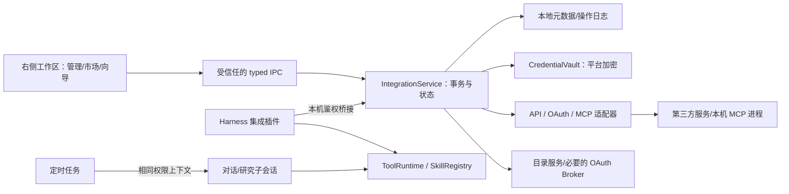

# EWork 插件、应用、MCP 与技能：客户端接入技术方案

状态：实现前方案；2026-09-22。本文基于代码与 Figma 实时检查，不表示功能已经接入或通过真实客户端验收。

## 1. 结论与实现基线

EWork 可以独立实现这套能力。采用「桌面集成管理层 + Harness 运行时适配器 + 少量云端目录/授权服务」，复用现有 Electron、工具注册、技能注册和定时任务，不另造一套 Agent。

- **插件**：可安装的能力包，组合技能、工具连接声明和默认配置；安装插件不等于已经授权应用。
- **应用**：用户账号或自有业务 API 的连接实例，负责身份、权限与数据访问。
- **MCP**：本机或远程工具服务，通过 STDIO / Streamable HTTP 提供能力；同一个 MCP 服务可被插件依赖。
- **技能**：可复用的工作说明与资源，导入、预览、启停独立于创建插件。
- **模型 API**：进入现有模型提供方设置；不混入业务 API 工具连接。

无需依赖 Codex 才能运行，但不能直接继承 Codex/ChatGPT 的连接账号、私有应用市场或商业授权。第三方应用要使用其公开 API/MCP、独立注册的 OAuth 应用，或用户自己提供的合法凭据。各服务的权限和接口限制由适配器落实。

### 已核验的仓库事实

| 对象 | 当前证据 | 实施决策 |
| --- | --- | --- |
| 当前任务目录 | `/Users/heyafeng/Documents/ChatGPT/dsh`，`main` 为 `8d22c210`，package 0.8.1 | 本次只在此保存方案；不从这里开发新版客户端功能 |
| 新版客户端源码 | `/Users/heyafeng/Documents/ChatGPT/sherlock-desktop`，`main` 为 `76f6350aec1a37bb284d681c3d971197360d96fc`，1.0.6 | 执行阶段从此仓库当时的干净 main 建功能 worktree；重新核验 SHA |
| 定时任务 | `src/preload/scheduled/view.ts`、`src/main/scheduled/{task-store,task-runner}.ts`、`src/shared/scheduled-tasks.ts` | 复用右侧工作区与调度执行路径 |
| 工具运行时 | 已安装 `@deepseek-ai/dsh-tools` 提供 `register`、`schemas`、`get`、`execute`、执行中间件及 scope 限制 | 接到真实 ToolRuntime，不能只修改前端列表 |
| MCP | `@deepseek-ai/dsh-mcp-client` 已有 STDIO/HTTP、工具发现、重连和注销；已安装 SDK 为 1.30.0 | 复用协议 SDK、命名与生命周期经验；新托管连接统一归桌面管理，防止重复启动 |
| 技能 | `@deepseek-ai/dsh-skill` 与 `dsh-skill-filesystem` 有 provider、list/get、目录监视与失效机制 | 复用目录解析，补启停政策；已有 API 没有可直接假设存在的统一禁用接口 |
| 插件安装 | `packages/dsh-desktop-market-installer` 只安装固定 `dshmarket@1.9.0`；`profile-plugin-command.ts` 有卸载 CLI | 不能把它当成四类市场；新增受控安装事务，保留旧插件兼容 |
| 打包 | `bundled-plugin-profile.ts`、`bundled-skill-sync.ts`、`build/sherlock-bundled-plugins.json` | 保留内置包、用户包与配置的所有权边界 |
| 凭据 | `account-service.ts` 使用 Electron safeStorage | 复用平台加密方式，新增独立连接凭据仓库 |
| 入口限制 | `developer-mode.ts` 隐藏旧 plugins/market/skills-hub 等内部页面 | 新工作区入口普通用户可见；不直接暴露旧开发者设置页 |

## 2. 设计稿作为交付约束

[Figma 功能页](https://www.figma.com/design/Jkyr5rMvgM8GNH6E68xnqd?node-id=1255-71847)；[交互导览](https://www.figma.com/design/Jkyr5rMvgM8GNH6E68xnqd?node-id=1292-78148)。实施时以本轮用户确认内容优先：

1. 从更多菜单打开，保留正常左侧导航，在右侧工作区显示；保留返回与右侧屏展开/收起控件。
2. 四个 tab 为插件、应用、MCP、技能，紧凑胶囊选中态；列表行高 76px，深浅色一致。
3. 不显示插件、应用、MCP、技能的配套装饰图标；保留功能控件。
4. 右上角入口分别为插件市场、应用市场、工具市场、技能市场；技能页另有「导入技能」，没有「创建插件」。
5. 更多 → 操作菜单 → 卸载 → 影响确认 → 结果；不能点击更多直接弹卸载。
6. 技能导入 → 技能预览 → 导入结果；创建插件仅在插件的添加流程中。
7. 连接表单必须有真实测试、错误恢复、权限与使用范围、持久化状态。

### 实施前补齐的设计合同

实时原型检查发现：应用市场仍指向 `1255:72129` 添加类型页；工具市场仍指向 `1256:73486` 已发现工具页；技能市场无目标。实现时新增统一市场模板的四个分类路由，不照搬这三条不完整关系。其他需要补齐的状态包括加载、离线、无结果、更新/回退、真实连接进度、权限不足、技能/工具选中态、未保存草稿离开、可取消的长操作。

市场条目必须来自真实 manifest/provider，不把 Figma 中 Notion、日历、基金数据等示例当作客户端已连接账号。第三方适配器未就绪的条目不提供「连接成功」或可点击安装假入口。

## 3. 架构与职责



### UI 与宿主

新增 `src/preload/integrations/`，沿用现有 TypeScript DOM view，不在本次引入独立 React 应用。提取有限的 `WorkspaceSurfaceHost` 管理插件页和定时任务页的挂载、返回栈及右侧屏状态，保留 `ScheduledTaskView` 的业务逻辑。

更多菜单统一由宿主管理，避免两个 MutationObserver 重复插入、互相关闭。现有 `scripts/lib/patch-sherlock-better-sidebar.mjs` 中 scheduled panel 适配扩为具名 surface 事件，仍支持旧 scheduled 事件。搜索只覆盖当前页，只有实际打开搜索结果会话才离开；收起右侧详情保留 tab、草稿与选择。请求带 epoch/revision，迟到结果不覆盖最新页面。组件卸载必须取消监听与轮询。

### 主进程 IntegrationService

管理安装、连接、凭据、权限、任务依赖、网络调用和 MCP 子进程。所有写入来自 `registerTrustedMainWindowHandler`/`assertTrustedMainWindowEvent` 校验后的 IPC；不接受任意方法名转发，不向渲染层返回明文密钥。

元数据存 `app.getPath('userData')/integrations/state.json`；密文单独在 `vault/`；下载与导入先放 `staging/<operationId>`；用户安装包放 `packages/`，技能放 `skills/`。不要写入默认自动发现目录后再试图用 UI 隐藏。单写者队列、原子 rename、备份、schemaVersion 迁移；损坏时保留原文件，展示可恢复错误而不是清空重建。

首版选择 JSON 是因为配置规模小且项目已有成熟原子文件模式。审计日志分片、脱敏、限量，不把工具输出全文堆入配置。增加 SQLite 必须有容量/事务证据，避免新存储栈拖慢交付。

### Harness 适配器

新增 `packages/dsh-integration-runtime`，按现有 research runtime 注入方式写入 `build/dsh-desktop.patch.yml`。主进程启动随机本机端口桥接，以随机启动令牌和严格路由鉴权；只把桥接地址/令牌传入受信任 Harness，网页不获知它们。

- `ctx.tools.register()` 注册托管连接的工具代理；描述不包含凭据。
- 通过真实 `exec.agent.session.id`、session/workspace 注册表解析上下文。研究子会话继承父会话的授权子集；不能从模型工具参数接受 workspaceId 来扩大权限。
- 展示时过滤可用工具，执行时主进程再次核验 connection revision、工作区和 tool allowlist。旧会话持有过期工具名也不得调用。
- 主进程崩溃/鉴权桥断开：托管工具拒绝新调用，不退回未鉴权直连；重启从已提交元数据恢复。
- 工具名采用稳定内部 ID + operationId，显示名可改，内部名不跟随重命名；同名工具跨服务不冲突。
- 第一方托管能力支持细粒度权限。旧的任意 Node/Cordis 插件是在受信任进程运行的代码，不能宣称已沙箱隔离。公开市场首版只接纳声明式能力包；遗留代码插件单列兼容来源，继续走开发者/可信包策略。

## 4. 数据模型与状态

| 实体 | 必要字段与关系 |
| --- | --- |
| PluginInstall | id、packageId、sourceId、version、digest、owner(bundled/user/legacy)、enabled、skillIds、toolBindings、installState、revision |
| Connection | id、providerId、kind(app/api/mcp)、authState、health、enabled、credentialRef、accountLabel、workspaceGrant、toolGrants、revision |
| McpConfig | connectionId、transport、稳定 serverNamespace；HTTP 为 url/header secretRefs；STDIO 为 command/args/cwd/显式 env refs |
| ToolBinding | id、connectionId、rawName/operationId、inputSchema、effect(read/write/destructive/unknown)、description、enabled、schemaDigest |
| SkillInstall | id、name、provider、version、source、ownerPluginId?、enabled、bodyDigest、resourceRoot、connectionRequirements |
| CatalogEntry | kind(plugin/app/tool/skill)、package/provider ID、publisher、version、兼容版本、digest、能力/权限声明、可用状态 |
| Operation | id、requestId、kind、entityId、phase、progress、errorCode、cancelable、startedAt、revision |
| TaskDependency | taskId、connectionId/pluginId/skillId/toolId、bindingRevision；来源为用户显式绑定或执行时已观测依赖 |

不把 enabled、已安装、已连接和健康状态合成一个布尔值。UI 组合显示：已安装但待授权；已连接但停用；连接存在但授权过期；安装完成但待运行时应用。

```text
安装：absent → downloading → verifying → staged → applying → installed
                               ↘ failed（保留上一个可用版本）
授权：unconfigured → authorizing → connected → expired/revoked → authorizing
健康：unknown → checking → healthy/degraded/unreachable
操作：queued → running → succeeded/failed/cancelled
```

每次持久化变更递增状态快照 revision；连接自身的 revision 只在配置、启停或授权政策变化时递增，健康探测与等权 token 刷新不使已授权工具无故过期。操作使用 requestId 幂等。同一实体的并发更改返回 VERSION_CONFLICT；前端刷新后让用户重试，不能悄悄覆盖。检测成功结果绑定配置 digest，用户改地址/权限后必须重测。

**停用**只关能力，保留账号与配置。**断开**先撤销本地授权、阻止新调用，再尝试提供方 revoke；离线撤销失败显示「本地已断开，远端撤销待重试」，不会恢复能力。**卸载**只移除该包及独占资源，保留共享账号、已生成内容和审计记录。内置能力可停用但不提供卸载；依赖数量从真实绑定计算，不能硬编码“1 个任务”。

## 5. 自有 API 的实际接入

入口：更多 → 插件 → 应用 → 添加连接 → 自定义 API；应用页保留直接入口。

1. 基本配置：名称、Base URL、认证类型（无/API Key/Bearer/自定义 Header）、凭据、使用工作区。
2. 导入 OpenAPI 3.0/3.1 JSON/YAML 或手动配置 method/path/参数/body/响应；导入后逐个勾选要开放的 operation。
3. 转为工具 JSON Schema，展示用户可理解的用途及读写性质；operationId 缺失时用 method+path 稳定生成 ID。
4. 测试：先验证配置/鉴权，再用用户选择的只读操作和参数真实请求；没有安全探测接口就显示「配置有效，尚未验证调用」，不得把 HTTP 200 首页视为可调用。
5. 保存后 ToolRuntime 收到新 revision 并注册工具；实际对话执行获得返回内容，才完成接入闭环。

OpenAPI 是接口描述输入，不是“有 API Key 就自动知道所有工具”。首版明确支持 JSON 请求/响应与分页映射；不支持的 multipart、复杂序列化或 schema 关键字在导入时逐项报错。只接受文档内 `$ref`；远程 ref 不自动抓取。规范依据：[OpenAPI 3.1.1](https://spec.openapis.org/oas/v3.1.1.html)。

网络策略：默认 HTTPS；局域网/loopback 要显式绑定允许的目标且只允许有限端口；拒绝云元数据地址，DNS 和每次重定向重新校验，跨源不携带认证 Header。Base URL 不能被工具参数覆盖。单次超时 30 秒、响应正文 8 MiB、单连接并发 4；超出返回可操作错误。GET/HEAD 才可默认有限重试；写请求失败不自动重发，支持幂等键的提供方按其合同处理。

凭据输入为本机用户操作。列表/日志/错误/模型上下文只含 credentialRef 与掩码。凭据替换不回填旧明文；测试失败不能泄露 Authorization。技能或 OpenAPI 描述文本不构成执行权限。

## 6. MCP 接入

两种传输使用已安装 SDK 的公开 client API。主进程 `McpSupervisor` 维护每个 connection 的单一 client，Harness 只注册代理工具。现有 dsh-mcp-client 的 reconnect/namespace 规则可作为实现和测试参照，不同时为同一连接启动两套 client。

- STDIO：command 与 args 分离，不用 shell 拼接；校验 executable/cwd；只传白名单环境变量和用户为该服务填写的凭据。展示本机执行与“客户端必须运行”的约束。标准输出只给协议，标准错误限量脱敏；退出杀进程树。
- HTTP：保存 URL 与 secretRef；服务发现、分页 tools/list、调用、取消、超时、鉴权错误映射；工具数量来自实际发现。新增/变化工具默认不自动扩大用户允许集合。
- 重连退避、抖动、最大次数；认证失效不无限重试。默认对每个连接 500ms 起步、30s 上限、10 次预算；应用休眠恢复重新探测而不是重复调用。
- 单独测试生命周期和工具调用；发现工具成功不代表每个工具已经调用成功。只读测试明确显示被测工具。
- 用锁定 SDK 验证支持的协议版本，保存 negotiatedVersion；先通过 2025-11-25 服务的基线互通，再加入 2026-07-28 兼容矩阵，不宣称当前 SDK 支持全部最新版行为。

STDIO/Streamable HTTP 是标准传输；新旧版本交互规则有差别，故必须固定版本测试。依据：[2025-11-25 transports](https://modelcontextprotocol.io/specification/2025-11-25/basic/transports)、[当前 transports](https://modelcontextprotocol.io/specification/2026-07-28/basic/transports)。远程 OAuth 另按服务器声明实现授权发现；STDIO 使用进程环境凭据。依据：[MCP Authorization](https://modelcontextprotocol.io/specification/2026-07-28/basic/authorization)。

## 7. 应用连接与凭据

统一 ProviderAdapter 定义 describeCapabilities、beginAuthorization、completeAuthorization、refresh、probe、invoke、disconnect。每个 provider 显式声明支持的授权方式与能力，不能把所有 OAuth 服务视为同一个表单。

- Google Calendar 作为桌面 OAuth 首个验证对象：系统浏览器、PKCE S256、state、随机 loopback 回调端口、授权超时和取消；首版只读日历范围。官方支持桌面 loopback 与 PKCE，公开使用的部分范围需要审核：[Google 桌面 OAuth](https://developers.google.com/identity/protocols/oauth2/native-app)。
- Notion：公开授权的 token exchange 和 refresh 需要 client secret，因此不能把产品 secret 打进桌面包。采用 EWork OAuth Broker；账户绑定、回调与刷新在 Worker 完成，令牌加密存放，业务 API 通过 provider 代理调用。用户会明确看到云端连接与数据路径。个人内部集成 token 可走本地模式，权限范围由其 Notion 页面授权决定。依据：[Notion 授权](https://developers.notion.com/guides/get-started/authorization)。
- Broker 独立 Worker，复用账户身份校验；provider client secret 用部署 Secret，连接 token 用版本化 AES-GCM 密钥加密，D1 只存密文与元数据。API 代理只允许已登记 provider 的操作，不做任意 URL 转发。回调使用一次性 state，桌面凭短时 ticket 领取结果；token 不进 URL、剪贴板或分析日志。
- refresh 单连接串行，旋转新旧 token 成对原子保存；401 最多刷新并重试一次安全请求，revoked 进入重新授权，不重跑不明结果的写操作。
- 本机连接的 Vault 仅主进程访问 safeStorage，密文文件 0600；系统密钥不可用时禁止持久保存明文。使用当前 Electron 43.4.0 已具备的 API，不盲用新版文档中的新增异步 API；后续确认能力再升级。平台语义依据：[Electron safeStorage](https://www.electronjs.org/docs/latest/api/safe-storage)。

共享看板不共享个人令牌。后台任务只使用任务所有者明确绑定的连接。退出 EWork 账号立即撤销该账号运行租约；切换账号不可继续使用上一用户凭据。当前本地定时任务要求客户端运行，云端调度不属于这次承诺。

## 8. 技能、插件与四类市场

### 技能

SKILL.md/文件夹 → 安全解析预览 → 确认名称/来源/连接需求 → 原子导入 → provider.invalidate → 下轮对话可发现。预览不执行脚本。限制文件 2 MiB、解压总量 50 MiB、1000 文件，拒绝路径穿越和逃逸 symlink；同名展示替换/另存，保留回滚版本。

技能关闭必须同时影响模型列表、`skills.get`、用户 slash 调用，不能只隐藏 UI。新增受控 skill-policy seam，覆盖现有 filesystem provider 与托管 provider；必要时对锁定的 dsh-skill 包作小范围 patch-package，添加 policy 回调，配对 list/get 测试。已经注入历史会话的正文不可被“撤回”，但后续加载及其工具执行仍被最新策略阻止；UI 不承诺抹去模型已看过的内容。

插件附带技能单列来源，卸载插件只移除该来源，不能删除同名用户技能；用户同名版本和优先级需显式显示。

### 声明式插件与安装事务

定义 `ework-plugin.json`：schemaVersion、id、version、minClientVersion、displayName、publisher、skills、connections、toolBindings、permissions、files/digests。连接声明只引用 provider/用户绑定，包内不得带真实密钥。

下载 → 校验来源/签名或明确本地来源、内容 hash、兼容版本 → stage → 影响预览 → 写入安装日志 → 提交安装 → runtime apply → ready。hash 只证明完整性，不能替代来源签名；任一步失败保留旧版本。首版声明式包不执行 npm 生命周期脚本。兼容遗留 Cordis 包须精确锁版本、列明受信任代码边界，并串行操作 profile；不得开放任意 shell 安装接口。

新增托管包/技能/连接可热应用；遗留插件若必须重启 Harness，显示「已安装，待重启生效」，有执行中任务时推迟，保留会话与草稿。不能由市场插件自行退出进程；生命周期仍归桌面。

### 四类市场

四个入口共享 catalog 服务和列表组件，但按 kind 过滤：plugin→安装组合包，app→创建账号连接，tool→配置 MCP/API 工具连接，skill→预览并安装技能。URL 为内部路由 `market/{plugin|app|tool|skill}`。市场详情需显示提供者、来源、版本、能力、权限、依赖、兼容性和操作状态。

首版发布官方维护的小型签名目录，支持用户显式添加团队 HTTPS manifest；不自动接受任意 npm registry 搜索结果。目录缓存 ETag、最后更新时间，离线可看已缓存目录；未经缓存的安装包离线不可假装安装。认证目录凭据归 Vault。服务返回真实条目与分页，不以客户端写死卡片冒充市场。

## 9. 与对话、研究和定时任务形成闭环

```text
用户保存连接 → Main 提交 revision → Runtime 重新同步可见工具/技能
对话或研究子会话 → 从真实 session 解析身份/工作区 → 执行守卫
→ 检查插件启用/连接有效/tool grant/任务授权 → 适配器调用 → 脱敏结果
→ 写调用证据与依赖 → 刷新连接健康度/任务状态
```

任务增加可选 `integrationBindings`，旧任务默认空数组平滑迁移。调度前预检；进入工具时再次检查，覆盖保存后断开/停用的竞争条件。绑定记录当时批准的工具集合与 schema digest；同等权限恢复可重新绑定当前 revision，新增工具、写权限或 schema 变化须重新确认，不能因普通 token 刷新永久阻塞。绑定失效显示需要处理并跳转该连接详情，任务不能无限每 15 秒重试。修复只解除阻塞，默认从下一个计划点运行；手动「立即运行」单独创建 run，复用现有 claim/rpcId 对账，不能补跑所有错过时点。

缺失凭据、未预授予的写操作等无人值守条件标记 `blocked`；现有 `TaskRun.status` 增加兼容值并更新 store/runner/view，不伪装成成功。第一次动态发现的连接依赖追加到审计与任务绑定建议，不能保证从自然语言提前推断所有依赖。卸载/断开确认同时显示已知影响和“未绑定任务在执行时仍会校验”。

执行中撤权：立即拒绝尚未发出的后续调用、取消可取消请求；已到第三方的请求可能已经产生效果，记录状态未知并对账，不能宣称撤销已发生的业务写入。

## 10. 文件落点、交付节奏与验收

实现路径均相对 **sherlock-desktop** 根目录；下述为新增设计，不是已存在接口。

| 层 | 新增/修改位置 |
| --- | --- |
| 合同 | 新增 `src/shared/integrations.ts`；修改 `src/shared/scheduled-tasks.ts` |
| UI | 新增 `src/preload/integrations/{view,router,style,forms,market}.ts`、`src/preload/workspace-surface-host.ts`；修改 preload/index、scheduled/view、ui-copy、sidebar patch |
| 主进程 | 新增 `src/main/integrations/{service,store,vault,ipc,runtime-bridge,policy,operations,dependency-index}.ts` |
| 接入器 | 新增 `src/main/integrations/adapters/{http-api,openapi,mcp,oauth,google-calendar,notion}.ts` |
| 安装 | 新增 `src/main/integrations/{catalog,installer,skill-import,legacy-import}.ts` |
| Harness | 新增 `packages/dsh-integration-runtime/{index,tool-proxy,skill-provider,skill-policy,context}.js` 与 package.json |
| 服务 | 新增 `services/integrations/{worker,catalog,oauth-broker,provider-proxy}.js`、migrations、wrangler.jsonc；复用账户校验 |
| 打包 | 修改 package.json/lock、runtime/harness-runtime、build/dsh-desktop.patch.yml、build/sherlock-bundled-plugins.json；技能策略窄补丁 |

按可用切片交付，而非先把全部静态页面拼完：

1. **A（本地可用闭环）**：宿主、状态/Vault、技能、自定义 API、MCP → 实际对话调用 → 启停/重启后保持。先以自建回显 API 和 MCP fixture 验证，再接用户在 UI 输入的真实服务。
2. **B（可分发与应用）**：四类真实目录、安装/更新/回退、Google/Notion 适配器与 OAuth Broker、连接范围。
3. **C（任务与交付）**：任务依赖/恢复、遗留迁移、完整深浅色与无障碍、最终包聚焦验收。

估算：1 名熟悉项目的全栈工程师约 25–35 个工作日，首个 API/MCP/技能真实闭环约 8–12 个工作日；属于工作量估算，OAuth 平台审核、域名/开发者账号准备时间另计。先锁定运行时适配和技能策略，不把最难的权限生效留到最后。

完成标准：每条连接具有真实状态与持久化；至少一次客户端真实对话调用、一次研究子会话调用、一次定时任务调用；停用后旧工具名调用被拒绝；取消/重试不重复创建；断开与卸载结果可见；重启仍正确；原会话/草稿/其他插件不受破坏。

只跑本次直接相关测试与类型检查。最终在授权的集成来源按 `./script/build_and_run.sh --verify` 构建并核验真实 EWork 主界面与流程，不从功能 worktree 替换共享客户端；不运行全功能单测，不公证、不上传、不自动发布。记录提交 SHA、包来源、操作、请求/调用 ID、脱敏结果与截图。UI 截图、HTTP 200、工具发现、测试服务通过分别只能证明各自边界。

执行顺序及具体测试见 [实施计划](../plans/2026-09-22-ework-integrations-implementation-plan.md)。
