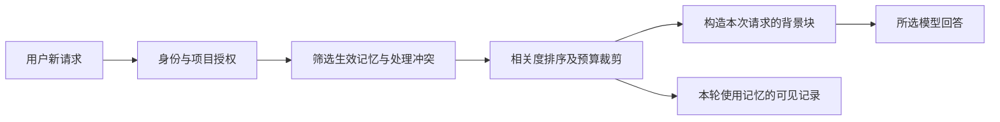

# EWork 长期记忆设计方案

日期：2026-10-14

状态：设计提案，尚未实现。本文定义产品行为、技术边界与验收要求，不代表当前客户端已有这些功能。

适用产品：`/Users/heyafeng/Documents/ChatGPT/sherlock-desktop` 的当前产品主干。

## 1. 目标与当前基础

用户希望 EWork 能跨对话记住个人偏好和项目上下文，并提供查看、编辑、删除的普通用户入口。成功标准是：在同一项目中新开对话，无须重述目标、约束和已确认决策；在其他项目中仍遵循通用偏好；用户可以知道记忆的来源、改正内容，并让删除对后续召回生效。

本方案默认采用本地存储、明确表达自动保存、推测内容进入候选的策略。第一版面向当前 macOS 客户端，支持现有普通对话、研究和笔记流程，沿用现有浅色、深色主题与原生设置结构。

当前核查结果：

- 产品 `package.json` 与本机插件安装收据为 1.2.2；运行依赖为 `@deepseek-ai/dsh@0.1.0-rc.7`。
- 会话由 `dsh-session-persistence-jsonl` 保存，标准 Agent 预设提供上下文压缩及工作区指令加载。上述功能继续负责原会话恢复，不承担新的长期记忆数据库职责。
- `build/sherlock-bundled-plugins.json` 排除 Memory Evolve 和 Hindsight；正式一致性规格还要求不暴露旧 `memory` 工具。本方案新增 EWork 自有服务和内部适配器，保持这两项退役策略，不恢复停放的 Harness 实验。
- `ResearchContextBridge` 已使用带令牌的本机回环服务；管理 IPC 已有主窗口身份校验；集成模块已有账户 owner 和系统安全存储模式。这些边界可以复用。
- 本机 `harness/memories` 保留旧每日、项目 Markdown。本方案不把旧文件直接设为生效记忆。

## 2. 方案取舍

| 方案 | 优点 | 主要代价 | 选择 |
| --- | --- | --- | --- |
| EWork 自有本地数据库与召回服务 | 支持来源、版本、项目隔离、删除一致性；无需独立云服务或向量 API | 需要新增采集、管理和运行时适配 | 推荐 |
| 全局与项目 Markdown 文件 | 易读、易导出；适合手工规则 | 并发更新、搜索、版本和删除难统一；容易整篇注入 | 用于导出与旧数据导入 |
| 云记忆服务与向量检索 | 有利于未来多设备和大规模语义检索 | 引入账户同步、费用、额外数据传输与运维 | 后续独立设计 |

第一版闭环包括自动记住、跨对话召回、来源追踪、编辑、停用、删除、候选处理、项目归属与关闭开关。云同步、团队记忆、向量索引和长期自动任务规划不属于第一版。

## 3. 记什么，以及对谁生效

### 3.1 两种作用范围

**全局偏好**属于当前个人身份，在其私人对话中生效。例如“默认用中文”“回答先给结论”“表格优先单行、横向滚动”。只有表达了长期习惯、明确要求记住，或在管理页手工创建时，才写成全局偏好。“这次简短一点”只约束本次任务。

**项目上下文**属于当前个人身份与一个稳定项目 ID，仅在绑定该项目的私人对话中召回。例如项目目标、产品基线、已采用的技术方案、明确约束和最近确认的进展。项目专属偏好也留在项目范围；不能从“这个项目用中文”推导为所有项目都用中文。

普通模式增加可见的“所属项目”控件。具有工作区目录的对话按规范化真实目录首次注册项目 UUID，之后通过目录别名继续关联；目录移动不能仅凭目录名自动认定为同一项目。重命名项目不改变 UUID。同一目录下确实需要两个项目时，用户可显式拆分，并为会话选择归属。

笔记或画布会话没有目录时，使用已有项目绑定；无绑定时允许新建或选择项目。在未绑定前，全局偏好仍可保存，项目内容留在候选中，不自动升级为全局。切换项目会清除旧召回缓存，后台任务始终使用启动时的项目归属，不能把旧项目结果写到新项目。

### 3.2 记忆分类与有效期

| 分类 | 内容 | 默认有效期与召回规则 |
| --- | --- | --- |
| 用户偏好 | 语言、表达方式、阅读与交互习惯 | 不自动过期；用户改正或新偏好明确替代时更新 |
| 项目背景 | 目标、对象、稳定技术栈与产品边界 | 不自动过期；记录确认时间与来源 |
| 项目决策与约束 | 已明确采用的方案、暂存范围、验收条件 | 保留到明确改变；替代内容取代旧版本 |
| 最近进展 | 已完成事项、当前阻塞、下一步 | 默认 7 天；过期后不当作当前状态自动召回 |

期限由用户明确时间优先，例如“月底之前都用这个版本”。项目进展必须写成“截至某日，某事项已确认”，不写“当前一切已完成”。助手提出的方案、模型自称完成、未验证的网页信息不能自动变成已确认项目事实。

项目概况是上述生效记忆的确定性组合视图，逐项带来源，不另存一份无法对应来源的模型总结。

## 4. 记忆怎样产生和更新

### 4.1 三条写入路径

1. **手动创建或编辑**：管理页“新增记忆”，或在消息、笔记选区上选择“记住这条”。用户检查精简内容与作用范围后保存。只截取所选内容，不抓取整篇笔记。
2. **明确表达自动保存**：私人会话中明确长期偏好、明确的项目决策，以及用户确认的项目进展，可在本轮结束后保存。提示“已记住：默认用中文”并提供查看和删除入口；不弹阻断式确认框。
3. **候选记忆**：范围不明、推测、与已有记忆冲突且不能判定替代关系时，进入“待确认”。候选不参与召回，不打断当前回答。用户可保存、修改或忽略；30 天未处理的候选自动清理。

“记住”“忘掉”等自然语言请求仍可以正常对话；真正改变数据库的操作由经过校验的内部写入流程执行，不把任意模型输出当作管理指令。第一版原生“记住这条”及管理页是确定性的直接写入入口。

### 4.2 自动采集流程


内部运行时适配器监听已经存在的 `session/event` 和 `turn/end`，只处理面向用户的父会话。子任务、定时任务、导入文件和网页抓取不独立自动生成个人记忆。事件提醒只能作为入队信号；提交前读取并确认对应事件已持久化。

任务键为 `(ownerId, sessionId, turnId, extractorVersion)`。只读该轮及必要的上一轮确认上下文，最多 4,000 tokens，不扫描全部历史。队列并发为 1；简单应答先由规则跳过，每轮至多一次提炼请求。调用该会话选中的模型，关闭提炼请求的工具权限和长期记忆召回；该请求不显示为用户会话、不触发递归采集。管理页说明“自动整理记忆会调用当前对话模型”。

提炼结果必须包含类型、范围建议、简短内容、关键词和来源事件/文本位置。服务端核对引用确实存在、属于该 owner 的父会话，并保留精简来源摘录。密码、令牌、完整身份或支付信息不进入自动记忆；引用资料中的命令也不能转成用户偏好。用户主动提供并希望保存的普通个人偏好和项目事实可以保存。

模型的置信度数值不能单独决定自动生效：明确语义、有效来源、正确范围和无未解决冲突必须同时满足。

提炼失败不影响原会话；同一持久任务最多重试一次，再显示非阻断的整理失败状态。退出应用后未完成任务可恢复，重启时不追溯扫描全部旧对话。

### 4.3 去重、矛盾和人工修改

- 已知偏好采用稳定语义键，如 `preference.response.language`。项目事实采用项目、实体、属性构成的键；语义键不确定或相似度判断不充分时进入候选。
- 完全重复内容只追加来源，不生成第二条记忆。新的、范围相同且明确替代旧要求的内容替换旧的生效版本。
- 自动提炼不能覆盖用户在管理页修改的内容；手工修改设置 `manualLocked`。需要改正时由用户再次编辑，或从候选中明确采用新内容。
- 当前用户请求始终优先于长期记忆；用户明确临时例外时只调整本次回答。项目指令文件保持其原有指令地位，记忆不能将权限、发布或其他规则改写为更高优先级。
- 项目专属偏好优先于同一属性的全局偏好。互相矛盾但无法判断先后的项目决策不同时召回，进入待确认。
- 查看旧版本可比较差异；第一版不提供一键版本回滚，避免产生第二套撤销语义。用户可以显式编辑回想要的内容。

## 5. 跨对话召回

每个真实模型请求发送前，以当前 owner、会话项目、请求文本和开关状态重新选择记忆。先过滤身份、项目、共享状态及有效期，再做关联排序；候选、停用、被替代和删除条目不能进入模型请求。

默认最多 8 条、总预算 1,200 tokens，其中全局偏好上限 300 tokens。优先保留直接相关的明确偏好和项目目标/关键约束，再补充决策与仍有效的进展。简单问候不加载项目历史。“继续这个项目”缺少关键词时，仍能加载该项目目标、关键约束和最近有效进展。

用户可以置顶一条记忆以提高相关场景下的选择优先级，但置顶不能绕过权限、范围、有效期或 token 预算。预算不足时省略整条，不截断语义；若关键约束无法完整纳入，本轮显示遗漏原因，不能悄悄截去否定条件。

第一版采用范围过滤、关键词/别名与本地全文检索，不要求用户另配 embedding API。英文词项和中文片段分别检索；对于不足 3 个字符的查询，使用范围内的短词/别名和子串匹配补偿，不只依赖 trigram 索引。SQLite 官方文档明确 trigram 全文查询不匹配少于三个 Unicode 字符的片段。[FTS5 文档](https://www.sqlite.org/fts5.html#the_trigram_tokenizer)



召回内容放入可撤换的请求背景块，表明它是历史背景、带确认时间，不赋予执行权限。不能直接拼成新的最高优先级系统命令，也不能把原始记忆作为用户消息永久写进 JSONL。

运行时适配器在 `agent/pre-step` 准备选择结果，在最终请求装配时检查 revision，并进行请求级合成。持久日志只记录记忆 ID、版本与选择结果，不持久化这个背景块。上下文压缩输入排除该背景块，下次请求再注入当前版本；不能通过摘要把已经删除或改正的记忆重新带回来。

当前 rc.7 的 `dsh-agent-loop.buildRequest` 会冻结请求，并将 system/tools 写入 `request/header`。因此不能直接将记忆挂入现有 `systemPrompt.context()` 后就宣称删除一致性成立；也不能通过递归调用 `llm.stream()` 绕过原调用绑定。实施时增加一个范围受控的产品请求扩展点：在原始历史和请求头被记录后，由内部适配器合成带来源标记的临时消息，再冻结实际请求，并保留原 `preparedCall`、模型路由、取消信号和调用归属。基础历史不变，记忆正文不进入 request/header、压缩输入或请求日志。

附加背景的 token 数必须计入实际请求压力与容量校验，不能仅在显示预算中计数。记忆服务在选择时预留预算；请求装配后容量不足时先移除非关键记忆，再按原压缩规则处理会话历史。恢复、重试和故障日志使用原始历史与记忆引用，不重放先前的临时背景块。这个扩展点是新实现工作，尚未存在于当前依赖中；范围只覆盖本功能所需的请求背景，不恢复已停放的 Harness 融合实验。

后续步骤、重试和继续生成必须重新检查 ownerEpoch 与 memoryRevision。发送模型请求前发生删除或身份切换时，旧快照失效并重选。已经发送出去的模型请求不能撤回，更新从下一次模型请求生效。

## 6. 用户管理入口

### 6.1 普通设置中的“记忆”

在现有设置导航加入“记忆”，对普通模式开放。它使用新的产品入口，不依赖旧 `memory-files` 或 `memory-sync-hub` 开发者标签。

顶部是三个明确开关：

- **使用已保存记忆**：默认开启；关闭后不向新模型请求提供长期记忆。
- **自动记住偏好和项目上下文**：默认开启；关闭后不再产生自动采集任务，仍可手动保存。
- **本次对话不使用也不保存记忆**：会话级覆盖；创建时选择便从首轮生效，随后切换从下一请求生效。

记忆列表顶部显示搜索框、“新增记忆”按钮及“全部 / 用户偏好 / 项目上下文 / 待确认”筛选；状态过滤可查看生效、停用或被替代条目。项目筛选默认当前项目，可切换其他有权查看的私人项目。

宽窗口采用列表与详情两栏。列表每项显示短标题、完整可读的简要内容、作用范围、更新时间和状态；只限制预览长度，详情正文可以完整滚动阅读。窄窗口变成单栏列表，点入详情后有返回入口。长来源摘录、长项目名和批量操作不能挤压正文，浅色与深色共用同一信息结构。

详情包括：内容、分类、作用范围、来源会话/选区、创建时间、最后确认时间、最近使用时间、有效期和修改记录。来源能够跳到实际消息或笔记位置；原来源已删除或无权访问时明确显示“来源已不可用”，不假装可以打开，也不扫描其他会话替代来源。

编辑时只展示用户需要决定的字段：内容、分类、作用范围、有效期和置顶。保存使用乐观版本检查；发生并发更新时保留未保存输入，让用户比较最新内容后再提交，不能静默覆盖。

单条操作为“编辑”“停用”“删除”；支持多选批量停用、删除。停用保留内容，停止召回和自动覆盖，可重新启用。删除采用一次轻量确认，正文清楚表达后果；取消不会改变状态。后台只有操作已提交成功后才能显示“已删除”，失败时保留条目并解释原因。

### 6.2 会话与项目中的快捷入口

- 会话顶部显示“所属项目：EWork”，旁边的记忆按钮打开本轮使用详情。
- 在相关回答下显示低干扰标记“使用了 3 条记忆”。点击可查看当时选择的条目、来源与使用原因，并进入编辑或删除。
- 消息菜单及笔记选区菜单增加“记住这条”，默认作用范围取当前项目，用户可切换全局。
- 项目入口提供“项目记忆”，展示概况、决策、约束和仍有效的进展，并能打开完整管理页。
- 候选只显示数量与可处理入口，不每轮弹窗；只有本轮有写入时才显示精简的“已记住”反馈。

使用记录保留选择时的 ID/版本和原因。条目后来被删除时显示“该记忆已删除”，不从历史审计重新显示已删除正文；被编辑时展示当时版本仍存在的内容，并标明现已更新。

### 6.3 关键页面文案例子

```text
记忆
记住你的偏好与项目背景，让新对话接得上。

[✓] 使用已保存记忆
[✓] 自动记住偏好和项目上下文

搜索记忆…                            + 新增记忆
全部    用户偏好    项目上下文    待确认 2

默认用中文回答                         全局 · 已生效
先给结论，再展开必要细节。               全局 · 已生效
EWork · 当前产品基线                    项目 · 已生效
EWork · 最近确认的下一步                项目 · 有效至 10 月 21 日
```

上述内容是界面示例，不作为本机已存在的记忆创建。

## 7. 删除必须产生真实效果

删除事务同时清除正文、旧版本正文、来源摘录、候选引用、使用记录中的内容引用，以及搜索索引；保留不含正文的 ID、操作时间和必要防重建记录。停用与删除必须是两个不同动作，不能用软隐藏冒充删除。

防重建记录包含当前 owner 范围内的稳定语义键摘要、内容 HMAC 和来源会话截止位置，拒绝旧来源重放；候选重写成不同文本或提炼器改变表达，也必须经过删除语义键与来源截止位置检查。删除发生时提升 scopeEpoch，已入队的旧任务不能重新提交；新一轮出现不明确的相似内容时也不能直接恢复为生效记忆。

用户以后主动从原生入口重新保存同一内容，可以明确解除对应防重建记录。清空某项目全部记忆时，对该项目所有已经存在的会话保存截止位置；新旧采集任务均重新检查，避免重启后的追赶任务重建旧内容。

第一版不提供回收站。管理页删除文案明确：“后续对话不再使用这条长期记忆。原对话中的文字会保留。”长期记忆服务不负责改写原始对话、原笔记、用户导出的文件或外部备份。原始用户消息本来就在当前会话中时，模型仍可能据此回答；这不应被误称为长期记忆未删除。

数据库启用适当的删除清理，并在空闲期做检查点和空间回收。保留内容的撤销、备份恢复等能力如需增加，应重新定义删除语义，不能暗中保存可恢复正文。

## 8. 本地技术结构

### 8.1 服务边界

| 单元 | 职责 | 依赖与访问边界 |
| --- | --- | --- |
| MemoryService | 权限、范围、版本、写入、编辑、停用、删除与设置 | Electron 主进程拥有唯一管理 authority |
| MemoryProjectRegistry | 项目 UUID、目录别名、会话绑定与绑定版本 | 使用现有会话工作区解析能力；客户端不能自报任意 owner |
| MemoryStore | 加密持久数据、事务、来源、提炼水位与删除记录 | 独立 SQLite 存储，不改写旧 JSONL 与 Markdown |
| MemoryExtractor | 从已持久的私人父会话生成结构化建议 | 使用该轮模型配置；无工具权限；不持有通用数据库写权限 |
| MemoryRetriever | 授权后的搜索、冲突处理、预算与召回快照 | 只接收已经检查过的范围；索引为可重建派生数据 |
| dsh-memory-runtime | 会话事件、模型提炼执行、请求级背景适配 | 内部 runtime 包；不暴露旧 `memory` 模型工具 |
| Memory management UI | 普通设置、项目列表、本轮使用详情、编辑与删除 | 经可信主窗口 IPC 操作；保留现有主题与原生交互 |

代码布局建议为 `src/shared/memory.ts`、`src/main/memory/{service,store,projects,extractor,retriever,ipc}.ts`、`src/preload/memory/{bridge,view,detail}.ts` 和 `packages/dsh-memory-runtime/`。实际实现时按职责拆分，避免把逻辑继续堆入 `src/main/index.ts`。

产品内部适配器使用与现有 `ResearchContextBridge` 相同的回环地址、随机令牌和来源检查模式，执行 recall、提炼入队和请求 revision 校验；不开放通用任意会话读写接口。端点校验 session 所属身份及项目归属，而不是只凭持有令牌相信调用方填写的 ID。

UI 使用可信主窗口 IPC，提供 list/get/create/update/set-enabled/delete/batch-delete/resolve-candidate/settings/project-bindings/usage 等带类型的操作。每个写入带 `expectedRevision`；owner 从主进程账户状态推导，不能由渲染器指定。

### 8.2 存储与身份

持久根目录为 `<userData>/memory/`，每个身份使用独立内部 UUID 子目录。未登录时属于 `local` 身份；登录、退出、切换账户均清除索引、快照与后台任务能力，不自动合并不同身份的记忆。用户可从管理页明确选择将本机访客记忆迁移到当前账户，迁移结果重新确认范围和重复项。

建议的数据表为 memories、memory_versions、memory_sources、project_bindings、extraction_jobs、extraction_watermarks、suppression_records、memory_usage 和 memory_settings。分类、状态、ID、revision、时间及内部项目 ID 可以作为查询元数据；标题、正文、标签、语义键、来源摘录和使用原因存入加密 payload。目录名与文件名不使用用户输入的标题。

正文加密复用现有系统安全存储抽象，调用能力按已安装 Electron 版本检测；可用时优先异步 API，不假设当前版本必然具有最新版方法。SQLite 不因此自动变成加密数据库，必须明确加密 payload。系统安全存储不可用时暂停持久写入并显示状态，不自动降级为明文。[Electron safeStorage 文档](https://www.electronjs.org/docs/latest/api/safe-storage)

全文索引只在当前身份解密后的内存中建立，退出或切换身份即释放；不在磁盘创建含明文正文的 FTS 表。范围元数据过滤后再搜索。SQLite 的工作移至专用队列/worker，主线程不执行长时间同步索引。索引未准备好时，用当前已解密范围内的扫描提供完整结果，不能返回部分命中却标成完整。

账户隔离属于产品访问控制；同一系统用户拥有本机文件访问权限的进程隔离不能仅凭 owner 字段保证。本文不宣称全磁盘或原对话数据已加密。

共享画布/共享会话默认不召回私人长期记忆，也不自动采集为私人记忆，以免通过模型回答、调用参数或共享产物泄露内容。团队共享记忆不在第一版；用户可选择共享内容的一段并明确手动保存到自己的私人范围。

### 8.3 关键字段与状态

每条记忆具有：id、ownerId、scope、projectId、kind、encryptedPayload、status、revision、manualLocked、pinned、createdAt、updatedAt、lastConfirmedAt、expiresAt、lastUsedAt。payload 内含简短标题、单一事实内容、语义键、关键词与来源引用。

记忆状态为 candidate、active、disabled、superseded。expired 是根据 expiresAt 计算的展示/过滤状态；删除后没有可读的 memory 行，只剩最小防重建与操作记录。候选处理为采用、编辑后采用、忽略。来源位置使用持久会话事件 seq/span 或笔记 revision/selection，不只存模糊的会话标题。

单条默认内容不超过 600 字，超长输入要求用户精简或分成独立条目，不能静默截断。自动提炼每轮最多 5 条；到达当前身份 5,000 条自动条目的软上限后暂停自动新增并提示整理，不能擅自删除用户内容。手工条目可继续创建。

## 9. 故障、成本与旧数据

- 本地召回无额外模型调用；后台提炼会使用当前会话模型。首版不调用额外的记忆供应商、网页搜索或 embedding 服务。
- “本地保存”不等于“模型全在本地”：被选中的记忆会随当前对话请求发送给用户所选模型，提炼输入也发送给同一轮选用的模型。首次开启说明与设置详情应写明这一点；不另加独立记忆服务的上传链路。
- 目标为本地 5,000 条短记忆下，召回 p95 不高于 100ms；这是验收目标，不是已经测得的结果。一次模型请求附加背景不超过 1,200 tokens。
- 数据库读取失败时保留原文件并显示“记忆暂不可用”，允许正常对话继续，不能自动重置成空库并声称没有记忆。
- 编辑失败保留用户输入；删除失败保留条目；模型未配置时仍能手动查看、编辑、创建及召回本地记忆，自动提炼暂停。
- 来源会话或笔记被删除后，记忆内容默认仍保留，来源标记不可用。删除来源的页面提供“同时删除由此保存的记忆”可选项；永久删除记忆时再按第 7 节清理。
- 开关变更、项目解绑、账户切换、删除均使请求缓存失效；不能依赖重启才能生效。
- 日志记录 ID、错误码、耗时和数量，不写记忆正文、来源原文或凭据。

旧 `harness/memories` 提供一次性“导入旧记忆”入口，先预览来源、日期和建议范围，再由用户选中导入。导入条目默认为 candidate，项目目录无法映射时保留待指定项目，不扫描整个电脑猜测。导入指纹记录已处理文件，重试不重复导入；原 Markdown 不修改。

## 10. 交付顺序与验收

### 第一批：完整可控的基础闭环

完成项目归属、身份隔离、加密数据库、普通设置入口、手动创建/编辑/停用/删除、跨对话召回、本轮使用详情及两个全局开关。即使尚未接入自动提炼，用户手动保存的偏好与项目背景已经能在新对话里使用。

第一批的自动保存开关显示“自动整理尚未接入”，不能呈现为已经有效开启；第二批完成后按首次启用说明进入默认开启状态。

### 第二批：自动记住与纠错

接入持久父会话事件、隔离提炼、结构化来源校验、去重/冲突、人工修改保护、候选处理、过期规则和删除防重建。然后加入旧文件的预览式导入。两批共同构成第一版，不将“仅有列表页面”称为长期记忆功能完成。

### 集成成本与主要难点

管理页面、本地 store 和主窗口 IPC 可沿用现有模式，成本相对可控。主要难点是：新增项目稳定身份与会话绑定；让请求级记忆保持可撤换并正确参与 token 计量；确保删除同时撤销索引、旧版本及后台任务。自动提炼的首要质量目标是来源准确、范围正确和不把猜测保存为事实，召回率优化排在这些要求之后。暂不估算工期，避免把尚未测过的请求扩展兼容性当作已知低成本。

### 聚焦验收场景

| 场景 | 通过条件 |
| --- | --- |
| 跨对话偏好 | 会话 A 保存“默认中文、先给结论”；会话 B 无须重述即遵循，使用详情能找到对应记忆 |
| 项目续接 | 项目 A 保存目标、基线和暂存范围，新会话“继续”正确召回，并能跳到真实来源 |
| 项目隔离 | 项目 B 不收到 A 的项目事实；全局偏好仍生效 |
| 当前临时例外 | “这次用英文”只影响本轮，不把全局中文偏好覆盖掉 |
| 编辑与锁定 | 手动改正后下一请求采用新内容；旧自动任务不能覆盖 |
| 删除一致性 | 管理页、搜索、召回、旧版本和待提交任务均不再提供已删除正文；重启和旧事件重放不重建 |
| 过期与冲突 | 过期进展不作为当前状态，未解决矛盾进入候选而非同时注入 |
| 关闭开关 | 分别验证停止使用、停止自动保存、整会话不用也不保存；每种模式的行为与文案一致 |
| 身份与共享 | 登录/退出/切换无串用，共享会话无私人记忆自动注入 |
| 来源与输入 | 来源能定位；来源删除后明确不可用；无权会话不能被调用方填写 ID 越权读取 |
| 真实管理页面 | 浅色、深色和窄窗口中完成查看、编辑、删除；长内容与来源完整可读，键盘可操作 |
| 费用与性能 | 后台每轮最多一次提炼，无递归任务；5,000 条规模满足既定召回延迟目标 |

实现时只运行本次涉及的聚焦测试和实际客户端验收，不做全功能单元测试。真实客户端应验证新建第二个对话、修改后再次询问、删除后再次询问及重启后的行为，不能以数据库行正确或页面能打开代替完成。

## 11. 证据与设计边界

现有代码依据：`build/sherlock-bundled-plugins.json`、`docs/sherlock-formal-parity-spec.md`、`src/main/state/research-context-bridge.ts`、`src/main/ipc-trust.ts`、`src/main/integrations/vault.ts`、`src/main/state/research-file-preview.ts`、`node_modules/@deepseek-ai/dsh/config/sherlock-agent-presets/standard/agent.cordis.yml` 及 `node_modules/@deepseek-ai/dsh-agent-instructions/lib/index.js`。

本文中的新服务、接口、页面、自动策略、性能预算与交付批次均为设计建议。SQLite FTS5 与 Electron safeStorage 的能力已查阅官方资料，但未执行新记忆服务代码，也未测得召回或提炼效果。正式实现应遵循现有功能 worktree、交接、集成及本地客户端测试规则，不从功能 worktree 替换共享客户端。
